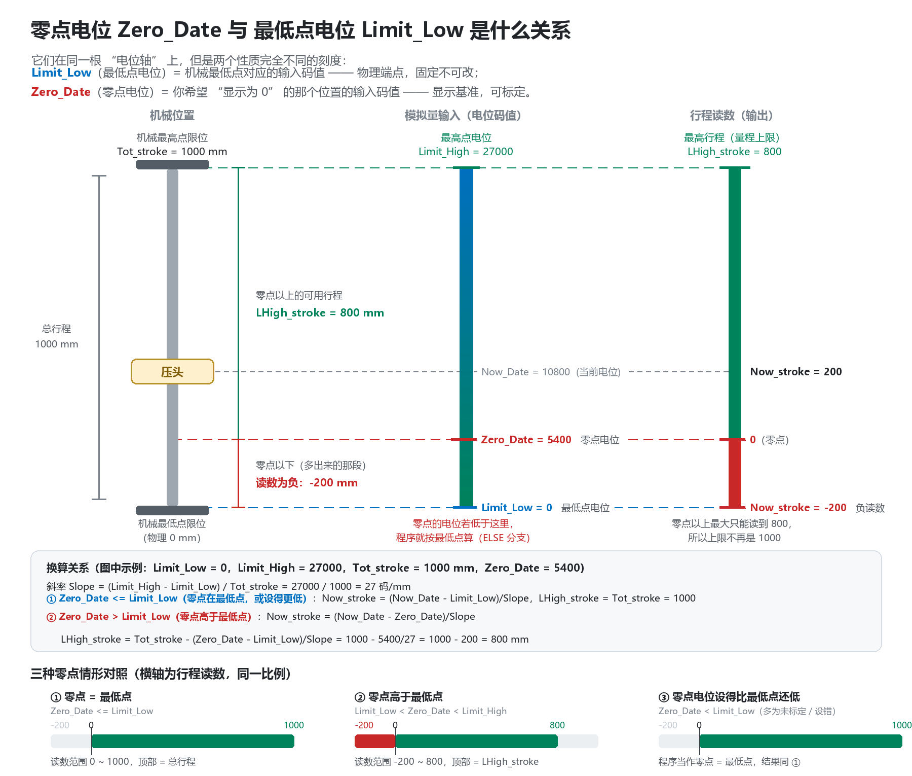
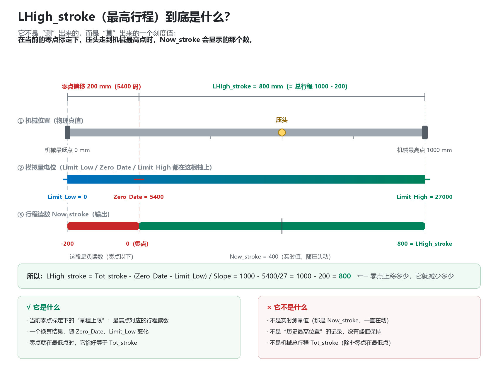

# 极性自适应的两点线性标定与零点偏移换算（CODESYS 3.5 库）

把一根模拟量尺（电位/码值）换算成实际行程：两点线性标定求斜率，极性自适应处理「电位随行程增大」和「电位随行程减小」两种安装方向，零点标定后按偏移换算，并给出当前零点下的量程上限。

## 工程信息

| 项 | 内容 |
| --- | --- |
| 平台 | CODESYS 3.5，库工程（`.library`） |
| 编程 | 结构化文本（ST），按 PLCopen 风格封装状态机 |
| 规模 | 597 KB |
| 最近修改 | 2026-10-15 |

## 接口

| 类别 | 变量 | 说明 |
| --- | --- | --- |
| 输入 | `ENI` | 使能，上升沿触发一次标定 |
| 输入 | `Teach` | 手动校准 |
| 输入 | `Limit_High` / `Limit_Low` | 最高点 / 最低点的电位（按**物理位置**命名，不是数值大小） |
| 输入 | `Tot_Stroke` | 总行程（mm） |
| 输入 | `Zero_Data` | 零点电位 |
| 输入 | `Now_Data` | 当前电位（实时采样） |
| 输出 | `Now_Stroke` | 当前行程（相对零点，零点以下为负） |
| 输出 | `LHigh_Stroke` | 量程上限（= 最高点处的行程读数） |

## 算法

**1. 求斜率**

```
Slope = |Limit_High - Limit_Low| / Tot_Stroke      // 码/mm，恒为正
order = Limit_High > Limit_Low                     // 极性：TRUE 电位递增，FALSE 递减
```

**2. 按极性分两支换算**，减法方向相反：

| 情形 | 正极性（`order = TRUE`） | 反极性 |
| --- | --- | --- |
| 零点已标定（在量程内） | `Now_Stroke = (Now_Data - Zero_Data) / Slope` | `Now_Stroke = (Zero_Data - Now_Data) / Slope` |
| 量程上限 | `LHigh_Stroke = Tot_Stroke - (Zero_Data - Limit_Low) / Slope` | `LHigh_Stroke = Tot_Stroke - (Limit_Low - Zero_Data) / Slope` |
| 零点在最低点或更低 | `Now_Stroke = (Now_Data - Limit_Low) / Slope`，`LHigh_Stroke = Tot_Stroke` | 同左，改用 `Limit_Low - Now_Data` |

**3. 异常与边界**

- 零点跑到最高点之外（或 `Zero_Data = 0` 未标定）→ 判为无效，退回「零点 = 机械最低点」，本次不按偏移换算。
- 两点电位相等（`Limit_High = Limit_Low`）→ 两个分支都不执行，`Slope` 保持上一次的值，不会被写成 0。

**4. 标定量只在触发时算一次**

`ENI` 上升沿（`R_TRIG`）才重算 `Slope` 与 `order`，其余扫描周期只做乘除换算，避免每周期重复标定。

## 零点与量程上限的关系



`Limit_Low` 是机械最低点对应的固定码值，`Zero_Data` 是「希望显示为 0」的位置，两者可以不同。零点上移多少，量程上限就减少多少：

```
LHigh_stroke = Tot_stroke - (Zero_Date - Limit_Low) / Slope
             = 1000 - (5400 - 0) / 27 = 800 mm
```



`LHigh_stroke` 不是测量值，而是当前零点下的「刻度上限」：压头走到机械最高点时 `Now_stroke` 会显示的那个数。零点就在最低点时它恰好等于 `Tot_stroke`。

## 实现结构

库里有两种封装，对应两种调用习惯：

| 版本 | 特点 |
| --- | --- |
| 电平使能版 | `ENI` 使能 + `R_TRIG` 取上升沿，代码直白，适合直接嵌进现有程序 |
| PLCopen 状态机版 | `xEnable` / `xExecute` 输入，`xDone` / `xBusy` / `xError` / `eErrorID` 输出，内部按 `DORMANT` → `EXECUTING` → `DONE` / `ERROR` → `RESETTING` 迁移，每个状态一个 `prv_HandleXxxState` 方法 |

状态机版遵循 PLCopen 的边沿控制约定：`xDone`、`xError`、`xBusy` 互斥，且 `xDone` / `xError` 至少保持一个扫描周期；`xEnable` 复位后内部回到 `DORMANT`，所有输出初始化。

## 关键点

- **极性靠 `order` 判断，不靠改接线**：传感器装反了不用改硬件，改标定两端即可，程序自动识别。
- **两种零点基准共存**：`Zero_Data` 没标定或标到量程外时自动退回机械最低点，不会输出非法读数。
- **量程上限是算出来的**：`LHigh_stroke` 随零点变化，报警与软限位用它比用 `Tot_stroke` 更准。
